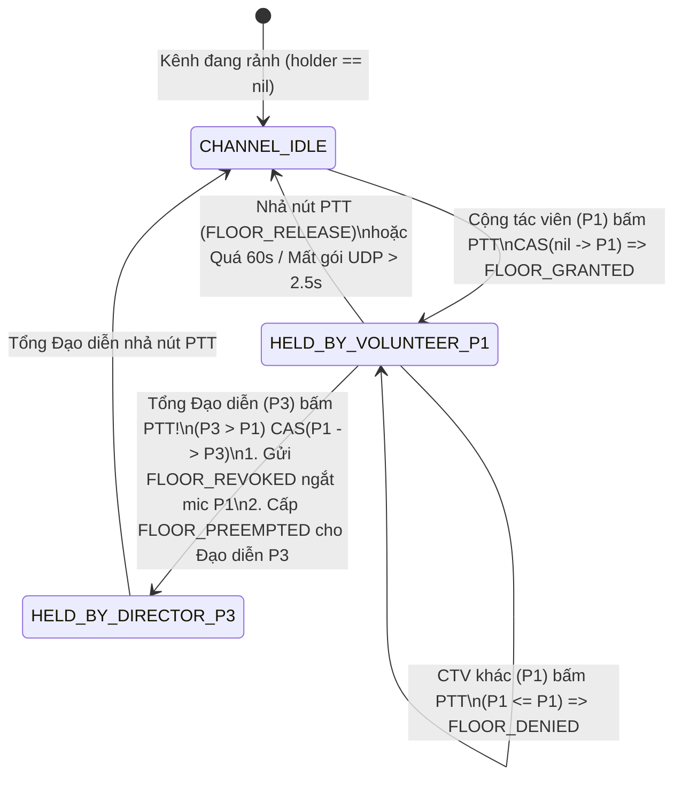

# TUẦN 4 — NGƯỜI 5: LẬP TRÌNH LOGIC FLOOR CONTROL (CAS) & PRIORITY OVERRIDE TRÊN SERVER (CẤP QUYỀN CHO TỔNG ĐẠO DIỄN CẮT NGANG / NGẮT MIC CỘNG TÁC VIÊN KHI KHẨN CẤP)

---

## 1. Đối chiếu Kiến trúc Dự án & Phân tích Nghiệp vụ (`1_BA`)

### 1.1. Quy tắc Nghiệp vụ Lõi của Bộ đàm Bán song công (Half-Duplex Floor Control & Priority Override)
Theo `1_BA/03_Yeu_cau_chuc_nang.md` (`FR-09`..`FR-15`) và `1_BA/08_Quy_tac_Nghiep_vu_va_Kich_ban.md` (`BR-08`..`BR-14`):
1. **Chống xung đột Mic khi 10 người bấm cùng một mili-giây (`CAS Lock-Free`):**
   - Trên mỗi kênh bộ đàm tại một thời điểm **chỉ duy nhất 1 người được giữ quyền phát sóng (`FloorHolder`)**.
   - Nếu hai Cộng tác viên (`Priority 1`) cùng nhấn nút PTT cách nhau vài mili-giây, Server sử dụng phép toán nguyên tử phần cứng **`atomic.Pointer.CompareAndSwap(nil, nextHolder)`** để đảm bảo đúng 1 người nhận `FLOOR_GRANTED` và người đến sau nhận `FLOOR_DENIED` (kèm tên người đang nói).
2. **Quyền Ưu tiên Cắt ngang của Tổng Đạo diễn (`Priority Override: Role 3 > Role 2 > Role 1`):**
   - Khi Cộng tác viên (`Priority 1`) hoặc Tổ trưởng Kỹ thuật (`Priority 2`) đang giữ mic báo cáo dài dòng mà sân khấu xảy ra sự cố khẩn cấp, **Tổng Đạo diễn (`Priority 3`)** nhấn nút PTT.
   - Server kiểm tra `requester.RolePriority > currentHolder.RolePriority` (`3 > 1` hoặc `3 > 2`), lập tức thực thi `CompareAndSwap(current, director)`:
     - Gửi bản tin **`FLOOR_REVOKED`** về máy Cộng tác viên để **tự động ngắt thu âm micro ngay lập tức** (phối hợp với Người 2 & Người 3 hiển thị thông báo bị Đạo diễn chiếm quyền).
     - Gửi bản tin **`FLOOR_PREEMPTED`** cho Tổng Đạo diễn phát sóng ngay lập tức với độ trễ `< 1 ms`.
     - Nếu Tổng Đạo diễn kích hoạt **Báo động Khẩn cấp Toàn sự kiện (`All-Call Emergency Override`)**, Server cưỡng bức thu hồi mic trên **tất cả 5 kênh cùng lúc**, đẩy gói thông báo khẩn cấp để **Người 4** kích hoạt rung liên tục + nháy đèn Flash Camera và **Người 2** hạ âm lượng kênh phụ `-12 dB`.
3. **Bộ đếm Thời gian Tự động Ngắt Mic (`Watchdog Stuck-Mic Protection`):**
   - **Giới hạn phát biểu tối đa (`MaxSpeakDuration = 60 giây`):** Chống trường hợp điện thoại bị cấn nút âm lượng trong túi quần làm tê liệt cả kênh.
   - **Tự giải phóng khi rớt mạng (`StaleAudioTimeout = 2.5 giây`):** Nếu người đang giữ mic đi vào thang máy mất sóng không gửi được gói `FLOOR_RELEASE`, sau `2,5 giây` không nhận được khung âm thanh UDP nào, Server tự động thu hồi mic trả lại kênh rảnh cho mọi người.

### 1.2. Sơ đồ Máy Trạng Thái Chiếm Quyền Mic & Cắt Ngang Ưu Tiên (State Machine)

---

## 2. Giải thích Chi tiết Mã nguồn [`floor_control_priority_override.go`](backend-tv5/Tuan_4_Floor_Control_CAS_va_Priority_Override/floor_control_priority_override.go)

1. **Cấu trúc `FloorHolder` & `ChannelFloorSlot`:**
   - Sử dụng `atomic.Pointer[FloorHolder]` (có sẵn từ Go 1.19+) giúp mọi thao tác kiểm tra ai đang giữ mic trên luồng âm thanh UDP 15.000 gói/giây hoàn toàn **Lock-Free (`O(1)`, không dùng `Mutex` gây nghẽn)**.
2. **Hàm `RequestFloor(channelID uint8, req FloorRequest)`:**
   - Vòng lặp `for` kết hợp `slot.holder.Load()` và `slot.holder.CompareAndSwap(...)` xử lý trọn vẹn 4 nhánh:
     - **Nhánh 1 (`current == nil`):** Kênh đang rảnh $\rightarrow$ Cấp quyền `FLOOR_GRANTED`.
     - **Nhánh 2 (`current.UserID == req.UserID`):** Gia hạn gói giữ mic của chính người đang nói.
     - **Nhánh 3 (`req.RolePriority > current.RolePriority`):** **Tổng Đạo diễn (`P3`) cắt ngang Cộng tác viên (`P1`)** $\rightarrow$ Thực hiện `CAS(current, next)`, trả về `PreemptedUserID = current.UserID` để Server bắn lệnh `FLOOR_REVOKED` ngắt mic máy Cộng tác viên ngay tức khắc.
     - **Nhánh 4 (`req.RolePriority <= current.RolePriority`):** Bị từ chối `FLOOR_DENIED`, trả về thông tin người đang giữ mic trên kênh.
3. **Hàm `TriggerDirectorEmergencyOverrideAllChannels(director FloorRequest)`:**
   - Khi có sự cố khẩn cấp (cháy nổ, y tế, sập nguồn), Tổng Đạo diễn bấm nút Khẩn cấp $\rightarrow$ Server quét qua toàn bộ các kênh `1..5`, cưỡng bức gán `FloorHolder` về cho Tổng Đạo diễn và phát sự kiện `EMERGENCY_ALERT` để máy của **Người 4** rung + nháy đèn Flash camera.
4. **Hàm `RunWatchdogLoop`:**
   - Chạy định kỳ mỗi `500 ms` kiểm tra 2 điều kiện an toàn: quá `60.000 ms` giữ mic liên tục (`REASON_MAX_DURATION_60S`) hoặc quá `2.500 ms` mất tín hiệu âm thanh UDP (`REASON_UDP_SILENCE_2_5S`) để tự động giải phóng kênh.
