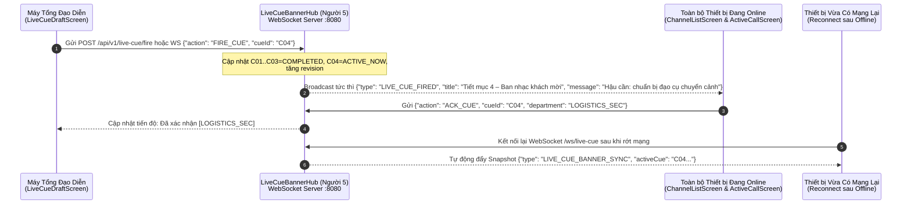

# TUẦN 5 — NGƯỜI 5: LẬP TRÌNH VÀ ĐỒNG BỘ HÓA TÍNH NĂNG THANH KỊCH BẢN (LIVE CUE BANNER) THÔNG QUA WEBSOCKETS

---

## 1. Đối chiếu Kiến trúc Dự án & Phân tích Nghiệp vụ (`1_BA`)

### 1.1. Tại sao Sự kiện cần Thanh Kịch bản Đồng bộ Thời gian thực (Live Cue Banner)?
Theo `1_BA/03_Yeu_cau_chuc_nang.md` (`FR-37`) và giao diện Android trên nhánh `Tuan-4` (`LiveCueCard.kt`, `ProfileLiveCueScreens.kt`, `FakeRemainingUiData.kt`, `ChannelListUiState.kt`):
- Trong môi trường đêm nhạc hoặc lễ hội có tiếng loa sân khấu `> 100 dB`, nhân sự cánh gà đôi khi không nghe kịp câu lệnh thoại dài hoặc vừa mới xử lý xong việc riêng nhìn vào màn hình điện thoại thì không biết **hiện tại chương trình đang diễn tới tiết mục (Cue) nào**.
- Ở **Tuần 5**, **Người 5** lập trình hệ thống **Đồng bộ Thanh Kịch bản (`Live Cue Banner`) qua WebSockets ([`live_cue_banner_ws.go`](backend-tv5/Tuan_5_Dong_bo_Thanh_Kich_ban_Live_Cue_Banner_WebSocket/live_cue_banner_ws.go))**:
  1. **Đẩy tức thì (`Real-time Broadcast < 50ms`):** Khi Tổng Đạo diễn bấm nút **`Đẩy lên mọi máy`** trên màn hình `LiveCueDraftScreen` (`ProfileLiveCueScreens.kt`) hoặc gọi `POST /api/v1/live-cue/fire`, Server lập tức đẩy gói WebSocket `LIVE_CUE_FIRED` xuống **toàn bộ các thiết bị đang kết nối** để cập nhật thẻ `LiveCueCard` trên đầu màn hình `ChannelListScreen` và `ActiveCallScreen`.
  2. **Đồng bộ 100% cấu trúc dữ liệu với Android (`LiveCue` & `ChannelListUiState`):**
     - Hỗ trợ đồng thời các trường của `data class LiveCue` (`title`: *"Tiết mục 4 – Ban nhạc khách mời"*, `message`: *"Hậu cần: chuẩn bị đạo cụ chuyển cảnh"*, `channelName`: *"Toàn sự kiện"*, `isPriority`: `true`) và các trường của `ChannelListUiState` (`liveCueHeader`: *"LIVE CUE · ĐANG DIỄN"*, `liveCueTitle`, `liveCueSubtitle`).
  3. **Đồng bộ tức thì cho Thiết bị Vào Muộn hoặc Vừa Có Mạng Lại (`Late-Joiner / Reconnect State Snapshot`):**
     - Ngay khoảnh khắc một điện thoại vừa kết nối lại WebSocket sau khi đi qua vùng mất sóng (Tuần 5 xử lý sự cố mạng Offline), Server tự động gửi ngay bản chụp (`Snapshot` `LIVE_CUE_BANNER_SYNC`) chứa **dòng chữ nhắc việc của tiết mục đang diễn ra (`ActiveCue`)** để máy đó bắt kịp kịch bản ngay lập tức mà không phải chờ Đạo diễn bấm lại.
  4. **Theo dõi Xác nhận Đã Đọc từ Các Trưởng ban (`Cue Read Acknowledgement`):**
     - Khi Trưởng ban Kỹ thuật hoặc Sân khấu bấm xác nhận đã thấy Cue trên thanh Banner (`ACK_CUE`), thiết bị gửi gói xác nhận về Server để cập nhật danh sách các bộ phận đã sẵn sàng (`ackedDepartments`).

### 1.2. Sơ đồ Luồng Đồng bộ Thanh Kịch bản (Live Cue Banner WebSocket Flow)

---

## 2. Giải thích Chi tiết Mã nguồn [`live_cue_banner_ws.go`](backend-tv5/Tuan_5_Dong_bo_Thanh_Kich_ban_Live_Cue_Banner_WebSocket/live_cue_banner_ws.go)

1. **Cấu trúc `CueItem` & `LiveCueBannerPayload`:**
   - Mỗi tiết mục (`CueItem`) lưu trữ đầy đủ: `CueID` (`C01`..`C05`), `TimeSpec` (`19:50`), `Title` & `LiveCueTitle` (*"Tiết mục 4 – Ban nhạc khách mời"*), `Message` & `LiveCueSubtitle` (*"Hậu cần: chuẩn bị đạo cụ chuyển cảnh"*), `ChannelName` (*"Toàn sự kiện"*), `IsPriority` (`true`), `TargetDepartments`, `Status` (`COMPLETED`, `ACTIVE_NOW`, `NEXT_STANDBY`, `UPCOMING`), và `AckedDepartments`.
   - `Revision` tăng dần sau mỗi lần chuyển tiết mục để thiết bị Android biết chính xác thứ tự phiên bản kịch bản mới nhất.
2. **Hàm `FireCue(cueID, directorName, customTitle, customSubtitle)`:**
   - Đánh dấu tất cả các tiết mục trước `cueID` là `COMPLETED` (*"LIVE CUE · ĐÃ QUA"*), đặt tiết mục `cueID` làm `ACTIVE_NOW` (*"LIVE CUE · ĐANG DIỄN"*), và đặt tiết mục kế tiếp làm `NEXT_STANDBY` (*"LIVE CUE · CHUẨN BỊ"*).
   - Hỗ trợ cả việc chọn tiết mục có sẵn trong kịch bản (`C01`..`C05`) lẫn việc Tổng Đạo diễn soạn nhanh dòng nhắc việc đột xuất (`CUE-HOT`) từ màn hình `LiveCueDraftScreen`.
3. **Hàm `AcknowledgeCue(cueID, department)`:**
   - Ghi nhận bộ phận nào đã sẵn sàng cho tiết mục đang diễn ra và đồng bộ lại trạng thái về màn hình của Tổng Đạo diễn.
4. **Hàm `ServeLiveCueWS` (`GET /ws/live-cue`) & `HandleFireCueHTTP` (`POST /api/v1/live-cue/fire`):**
   - Ngay khi thiết bị kết nối vào `/ws/live-cue`, Server lập tức đẩy `initialSnapshot` (`LIVE_CUE_BANNER_SYNC`) qua kênh đệm `SendChan` (buffer 64 gói) để đồng bộ trạng thái tức thì cho các thiết bị vừa khôi phục kết nối mạng.
