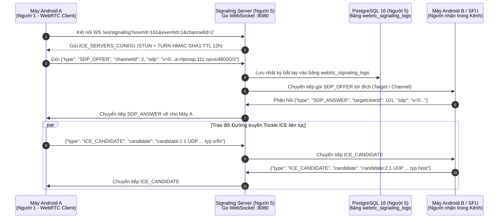

# TUẦN 1 — NGƯỜI 5: TRIỂN KHAI MÁY CHỦ BÁO HIỆU (SIGNALING SERVER) XỬ LÝ BẮT TAY SDP/ICE & THIẾT KẾ SƠ ĐỒ CƠ SỞ DỮ LIỆU BAN ĐẦU

---

## 1. Đối chiếu Kiến trúc Dự án & Phân tích Nghiệp vụ (`1_BA`)

### 1.1. Tại sao cần Máy chủ Báo hiệu (Signaling Server) ở Tuần 1?

Theo tài liệu `1_BA/05_Kien_truc_he_thong_ADR.md` và `2_code/11_De_xuat_Cong_nghe_Signaling_Server_Go_vs_Nodejs_4W1H.md`:

- Khi **Người 1** khởi tạo cấu hình WebRTC và máy chủ STUN/TURN trên Android, hai thiết bị di động nằm sau tường lửa NAT 4G/Wi-Fi **không thể tự biết địa chỉ IP/Port và thông số mã hóa âm thanh Opus của nhau**.
- **Người 5** xây dựng **Signaling Server (bằng Go + Gorilla WebSocket + Pion TURN)** đóng vai trò tổng đài trung gian ban đầu để:
  1. Cấp phát thông tin máy chủ **STUN/TURN ngắn hạn** (`HMAC-SHA1` theo chuẩn RFC 5389) giúp **Người 1** vượt tường lửa NAT.
  2. Chuyển tiếp các gói bắt tay **`SDP_OFFER`** (đề xuất phiên âm thanh Opus 16kHz Mono 20ms), **`SDP_ANSWER`** (chấp thuận phiên), và **`ICE_CANDIDATE`** (danh sách ứng viên đường truyền IP/UDP cục bộ, STUN Server-Reflexive, và TURN Relayed) giữa các máy trong cùng kênh sự kiện.

### 1.2. Sơ đồ Tuần tự (Sequence Diagram) Quá trình Bắt tay SDP/ICE do Người 5 Xử lý

### 1.3. Thiết kế Sơ đồ Cơ sở dữ liệu Ban đầu (ERD — PostgreSQL 16)

Theo `1_BA/06_Thiet_ke_Co_so_du_lieu_ERD.md`, sơ đồ CSDL ban đầu gồm **5 bảng cốt lõi**:

1. **`events`**: Quản lý thông tin sự kiện, mã PIN 6 số (`pin_code`), khóa bí mật `secret_seed` 32-byte và thời gian hết hạn.
2. **`channels`**: Quản lý 5 kênh bộ đàm mặc định của mỗi sự kiện (`CHỈ HUY`, `SÂN KHẤU`, `ÂM THANH & ÁNH SÁNG`, `AN NINH - Y TẾ`, `HẬU CẦN`) cùng mức độ ưu tiên mặc định (`default_priority` từ 1 đến 3).
3. **`event_sessions`**: Quản lý phiên kết nối của từng thành viên (`display_name`, `role_priority`, `hmac_secret`, `udp_endpoint`, `last_heartbeat_at`).
4. **`webrtc_signaling_logs`**: Lưu vết toàn bộ các bản tin trao đổi bắt tay `SDP_OFFER`, `SDP_ANSWER`, `ICE_CANDIDATE` phục vụ gỡ lỗi kết nối WebRTC cùng Người 1.
5. **`ptt_audit_logs`**: Lưu nhật ký vận hành (ai bấm nói, ai chiếm quyền ưu tiên, phát lệnh Cue nào).

---

## 2. Giải thích Chi tiết Từng File Mã nguồn của Người 5 trong Tuần 1

### File 1: [`001_init_schema.up.sql`](001_init_schema.up.sql) — Sơ đồ Cơ sở dữ liệu PostgreSQL 16

- **Dòng 6–15 (`CREATE TABLE events`):** Khai báo bảng sự kiện với ràng buộc `CHECK (char_length(pin_code) = 6)` đảm bảo mã PIN luôn đúng 6 chữ số (phục vụ màn hình nhập PIN của Người 3).
- **Dòng 18–29 (`CREATE TABLE channels`):** Khai báo bảng kênh liên kết khóa ngoại `ON DELETE CASCADE` tới `events`, kèm ràng buộc `UNIQUE(event_id, channel_index)` để mỗi sự kiện có các kênh từ `1..N` không trùng lặp.
- **Dòng 32–45 (`CREATE TABLE event_sessions`):** Lưu thông tin phiên của người dùng cùng khóa `hmac_secret BYTEA` (32 bytes) để xác thực gói âm thanh UDP.
- **Dòng 48–59 (`CREATE TABLE webrtc_signaling_logs`):** Lưu lịch sử trao đổi `SDP_OFFER`, `SDP_ANSWER`, `ICE_CANDIDATE` kèm `payload_json JSONB` để truy vấn cực nhanh trên PostgreSQL 16.
- **Dòng 73–86 (Seed Data):** Tự động khởi tạo Sự kiện mặc định (`PIN: 482910`) và 5 kênh bộ đàm chuẩn ngay khi khởi chạy.

### File 2: [`signaling_sdp_ice_server.go`](signaling_sdp_ice_server.go) — Máy chủ Báo hiệu Bắt tay SDP/ICE & Cấp phát STUN/TURN

- **Hàm `generateTurnCredentials(userID int, turnSecret string)`:**
  - Sinh thông tin xác thực TURN động theo chuẩn `COTURN / Pion TURN REST API`: tạo `username = "<unix_expiry>:<userID>"`, sau đó băm `HMAC-SHA1(turnSecret, username)` và mã hóa `Base64` làm `credential`.
  - Khi một máy Android kết nối vào WebSocket, Server gửi ngay gói `ICE_SERVERS_CONFIG` chứa danh sách STUN/TURN này để **Người 1** nạp vào `PeerConnection.RTCConfiguration`.
- **Cấu trúc `SignalingHub` (`clients map[int]*ClientConn`, `channels map[int]map[int]*ClientConn`):**
  - Quản lý danh sách kết nối WebSocket đang hoạt động trong RAM bằng khóa đọc/ghi `sync.RWMutex` giúp chịu tải hàng trăm kết nối đồng thời không bị nghẽn (`data race`).
- **Hàm `handleSignalingMessage(sender *ClientConn, msg SignalingPacket)`:**
  - Khi nhận `SDP_OFFER` hoặc `SDP_ANSWER`: Kiểm tra nếu có `TargetUserID` cụ thể (kết nối P2P 1-1) thì định tuyến thẳng (`unicast`) tới đúng máy đích; nếu `TargetUserID == 0` (kết nối nhóm/SFU trong kênh) thì quảng bá (`broadcast`) tới toàn bộ các thành viên khác đang ở trong cùng `ChannelID`.
  - Khi nhận `ICE_CANDIDATE`: Chuyển tiếp tức thì ứng viên mạng (`candidate`, `sdpMid`, `sdpMLineIndex`) với độ trễ `< 1 ms` để hoàn tất quá trình đục lỗ tường lửa NAT (NAT Hole Punching).
