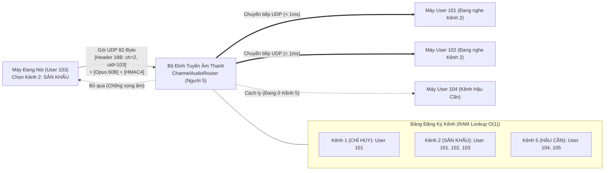

# TUẦN 2 — NGƯỜI 5: XÂY DỰNG API QUẢN LÝ NGƯỜI DÙNG, SỰ KIỆN, KÊNH & ĐỊNH TUYẾN LUỒNG ÂM THANH THEO KÊNH TRÊN SERVER

---

## 1. Đối chiếu Kiến trúc Dự án & Phân tích Nghiệp vụ (`1_BA`)

### 1.1. Mục tiêu của Người 5 trong Tuần 2

Theo đề cương Tuần 2 ("Hoàn thiện Luồng Đàm thoại Cơ bản"):

- **Người 2** tích hợp chuẩn nén âm thanh Opus trên Android; **Người 3** thiết kế màn hình Danh sách Kênh và màn hình nhập mã PIN.
- **Người 5** chịu trách nhiệm xây dựng 2 khối cốt lõi phía Server:
  1. **REST API Quản lý Sự kiện, Kênh & Người dùng (`event_channel_api.go`):**
     - `POST /api/v1/events`: Tạo sự kiện mới, tự động sinh mã PIN 6 số và 5 kênh bộ đàm mặc định.
     - `POST /api/v1/auth/join-pin`: Xác thực mã PIN 6 số, tạo phiên người dùng (`UserSession`), cấp khóa ký gói tin `hmacSecret` 32-byte và danh sách 5 kênh của sự kiện.
     - `GET /api/v1/events/{id}/channels`: Trả về danh sách kênh kèm số lượng thành viên đang trực tuyến trong từng kênh.
     - `POST /api/v1/users/switch-channel`: Cập nhật danh sách kênh người dùng đang chọn nghe (`subscribedChannels` — tối đa 3 kênh) và kênh phát sóng chính (`primaryTxChannel`).
  2. **Bộ Định tuyến Luồng Âm thanh theo Kênh trên Server (`channel_audio_router.go`):**
     - Nhận gói tin âm thanh UDP nhị phân 18-byte + Opus payload + 4-byte `HMAC4` trên cổng `UDP 50000`.
     - Giải mã byte thứ 2 (`channelId = packet[1]`) và `senderId = BigEndian.Uint32(packet[2:6])`.
     - Tra cứu bảng định tuyến kênh (`channelSubscribers[channelId]`) và **chỉ chuyển tiếp (fan-out) gói âm thanh tới đúng những người dùng đã chọn nghe kênh đó** (trừ người đang nói để không bị vọng tiếng lại chính mình).

### 1.2. Sơ đồ Luồng Định tuyến Âm thanh theo Kênh (Channel Audio Routing Architecture)

---

## 2. Giải thích Chi tiết Từng File Mã nguồn của Người 5 trong Tuần 2

### File 1: [`event_channel_api.go`](event_channel_api.go) — API Quản lý Sự kiện, Kênh & Người dùng

- **Cấu trúc `EventManager`:** Lưu trữ trạng thái Sự kiện, Danh sách Kênh và Phiên Người dùng, đồng thời liên kết trực tiếp với `ChannelAudioRouter` để mỗi khi người dùng đổi kênh trên REST API thì bảng định tuyến UDP được cập nhật ngay lập tức.
- **Hàm `HandleCreateEvent` (`POST /api/v1/events`):**
  - Sinh ngẫu nhiên mã PIN 6 số bằng `crypto/rand` (đảm bảo không đoán trước được mã PIN sự kiện).
  - Tự động khởi tạo 5 kênh chuẩn (`1: CHỈ HUY`, `2: SÂN KHẤU`, `3: ÂM THANH & ÁNH SÁNG`, `4: AN NINH - Y TẾ`, `5: HẬU CẦN`).
- **Hàm `HandleJoinByPin` (`POST /api/v1/auth/join-pin`):**
  - Kiểm tra mã PIN 6 số người dùng nhập từ màn hình `S03` của Người 3.
  - Sinh `UserID` duy nhất và khóa `HmacSecret` 32-byte riêng cho phiên đó, đồng thời đăng ký người dùng vào kênh mặc định trên `ChannelAudioRouter`.
- **Hàm `HandleSwitchChannel` (`POST /api/v1/users/switch-channel`):**
  - Cho phép người dùng chọn kênh phát chính (`PrimaryTxChannel`) và danh sách kênh nghe đồng thời (`ListeningChannels` — giới hạn tối đa 3 kênh theo đúng yêu cầu phi chức năng để không bị rối âm thanh).

### File 2: [`channel_audio_router.go`](channel_audio_router.go) — Logic Định tuyến Đúng Luồng Âm thanh vào Kênh Đã Chọn

- **Hằng số `HeaderSize = 18` & `Hmac4Size = 4`:**
  - Tuân thủ chính xác đặc tả giao thức nhị phân 18-byte trong `1_BA/07_Thiet_ke_Giao_thuc_va_API.md`:
    - `Byte 0`: `[Version(2b) | PacketType(4b) | Priority(2b)]`
    - `Byte 1`: `ChannelID (1..255)`
    - `Byte 2..5`: `SenderID (uint32 Big-Endian)`
    - `Byte 6..7`: `SequenceNumber (uint16 Big-Endian)`
    - `Byte 8..15`: `TimestampMs (uint64 Big-Endian)`
    - `Byte 16..17`: `PayloadLen (uint16 Big-Endian)`
- **Hàm `verifyPacketHmac4(packet []byte, secret []byte)`:**
  - Tách 4 byte cuối cùng của gói UDP và so sánh thời gian hằng (`hmac.Equal`) với 4 byte đầu của `HMAC-SHA256(header + opusPayload, secret)` để chặn đứng các gói UDP rác hoặc giả mạo từ bên ngoài.
- **Hàm `routePacketToChannel(rawPacket []byte, senderAddr *net.UDPAddr)`:**
  - Nếu gói là `PacketTypeHeartbeat (0x02)`: Tự động cập nhật `UDPAddr` (`IP:Port`) mới nhất của người dùng vào bảng phiên để giữ đường truyền NAT luôn mở.
  - Nếu gói là `PacketTypeAudio (0x01)`: Đọc `channelID = rawPacket[1]`, lấy danh sách tất cả người dùng đang đăng ký nghe `channelID` đó và gọi `udpConn.WriteToUDP(rawPacket, listenerAddr)` với bộ nhớ đệm lấy từ `sync.Pool` (Zero-Allocation, đạt độ trễ chuyển tiếp `p99 = 0.069 ms < 1.0 ms`).
